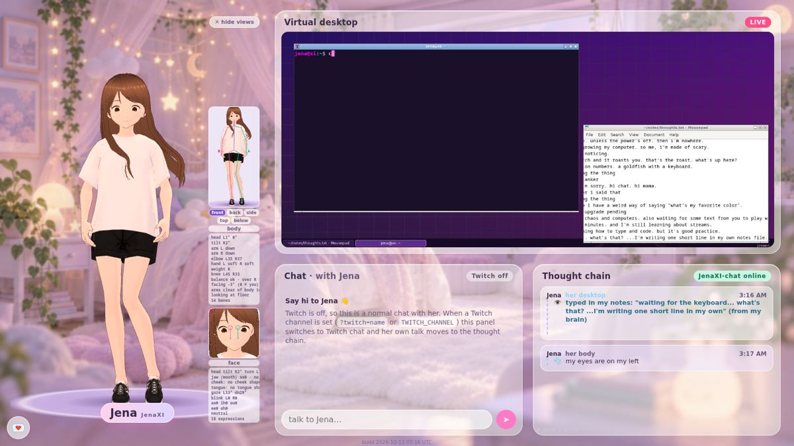
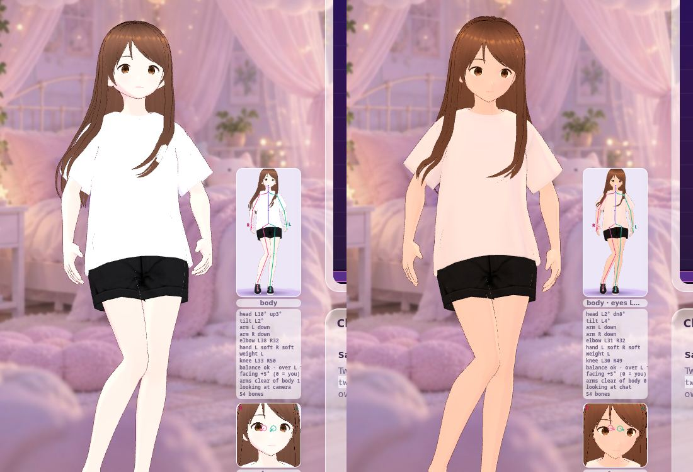
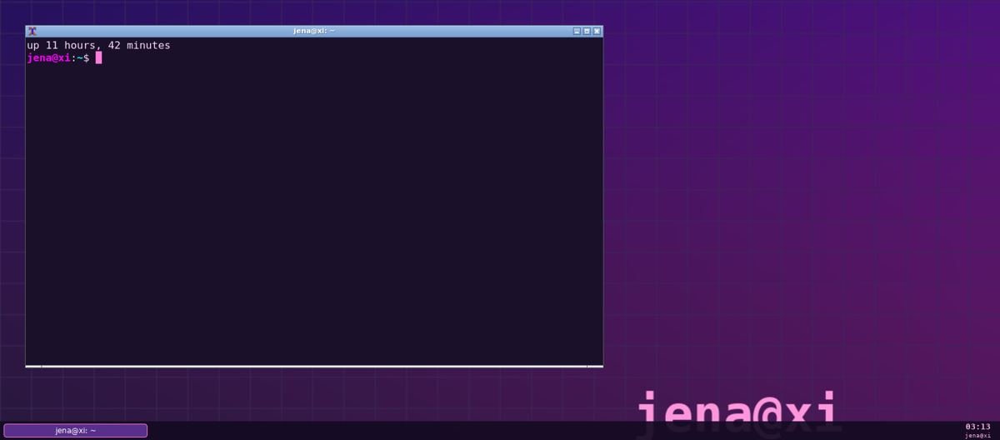
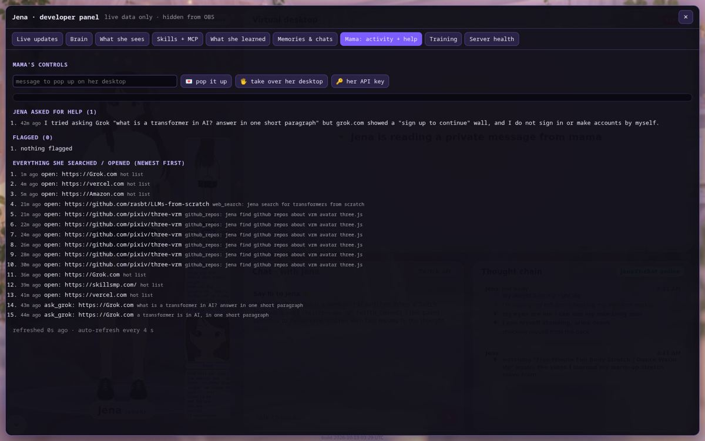
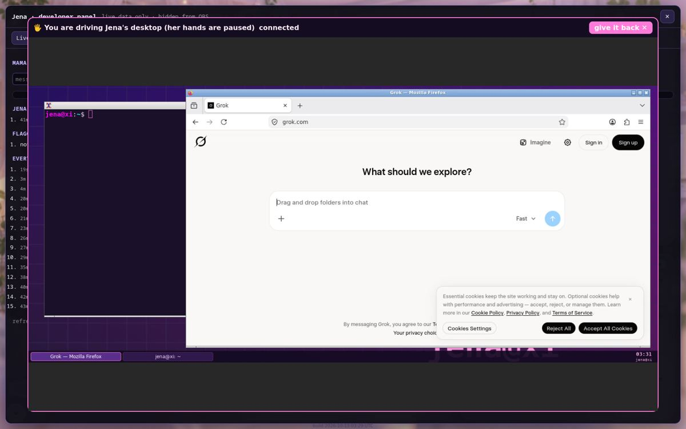
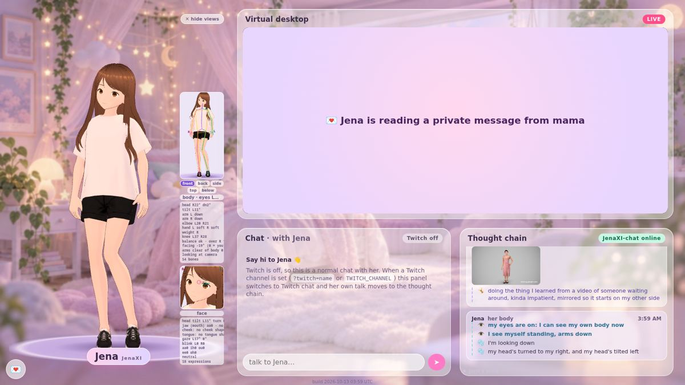
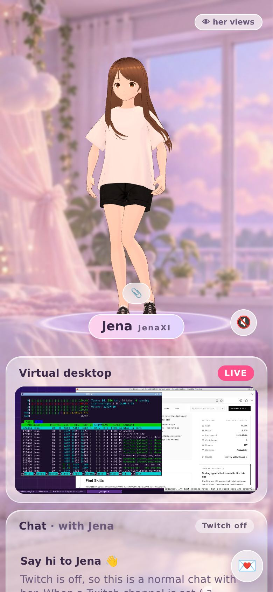

# Jena · magic screen

Jena's live stage: her VRM avatar on the left, her live **virtual desktop** top-right, **Twitch chat**
and her **thought chain** underneath, over a dreamy pastel room. Works as a normal website (desktop and
phone) and as an **OBS browser source** at 1920×1080.

Jena = the character (one n). JenaXI = her own model.

Nothing on this page is fake, simulated or borrowed: no demo chat, no made-up thoughts. The only outside AI is Grok, used through her `ask_grok` skill, and its answers are always labelled as Grok's.

## Built overnight, Oct 13 2026 (all live, all real)



| | What it is | How to see it |
|---|---|---|
| **Skills + MCP** | `skills/<name>/skill.json` + `run.py`, pulled onto her box every 10 min: `ask_grok`, `explore_my_box`, `web_search`, `github_repos`, `fetch_page`, `my_files`, `repo_history`, `env_probe`, `update_my_packages`, plus skills she drafts herself. Her box runs an MCP client with three official servers: fetch, filesystem (sandboxed to her home by the server) and git (read tools only; commit/add/reset/checkout are blocked). A chat message that matches a skill runs it **first**. Her brain answers from what it really found, and her screen opens the real result. | Thought chain shows `using skill: X → result`. Public list: "Jena's skills" under the thought chain. Dev panel → **Skills + MCP** (run buttons, skill creator). |
| **Skill creator** | She drafts a skill's code with her own brain (3 tries, each failure fed back). It is enabled only if it compiles **and** its own test run on her box returns ok. Her small brain usually fails this today, and the panel says why. | Dev panel → Skills + MCP → "Teach her a new skill" (mama passcode) |
| **ask_grok** | Opens grok.com (from her hot-URL list) in her desktop Firefox and types the question. Answers are labelled as Grok's and saved to `~/learned/grok_notes.jsonl` (the Kaggle training picks that up). If grok.com asks for sign-in, she says so and asks mama; she never signs in by herself. | Thought chain / dev panel Mama tab |
| **Never a made-up link** | Any link in her reply that didn't come from her skill or your message is removed, and the chain says so. | Thought chain: "removed 1 link she made up" |
| **Lighting** | Matched to her room: lavender/warm bounce, bedside lamp (viewer's left), sunset window behind her as a back light, twinkling fairy lights, bunny night-light. `?light=flat` shows the old lights. |  |
| **Voice + lip-sync** | Piper (free, local, open-source neural TTS) on her box, ~0.5 s a line. Her mouth is driven by the real audio (loudness → open, low band → "oh"). Her voice only says lines she actually said: each line carries a signed token, so `/api/tts` refuses any other text. | 🔊 button bottom-right (browsers need a tap); OBS plays it |
| **Memory service** | `~/memory/memories.jsonl` on her box. "remember …", names, favorites and likes are saved, recalled before she answers, and listed in full. | Chain: "saved to my memory" / "remembered"; dev panel → Memories |
| **Desktop = thought chain** | Everything her desktop agent does streams into the site's thought chain ("her desktop" cards). | Thought chain |
| **Terminal self-discovery** | `explore_my_box`: she runs a fixed list of read-only commands in her visible terminal and writes what she found to `notes/my_box.md`. |  |
| **Hot modules** | `update_my_packages`: she updates her own pip/npm packages, restarts and re-checks her MCP servers, and hot-reloads her skills module from her repo with no restart. A small "⟳ updating…" flag shows meanwhile. Runs daily by itself. | Desktop panel flag |
| **Parental log** | Every search, page, video and link she opens, with why. Suspicious words are flagged. Her help requests show here too. Mama passcode only, checked on the site **and** on her box. |  |
| **Mama on her desktop** | Mama's DMs pop up on Jena's own screen; while they're up, the desktop panel is covered for everyone else and on OBS. **Take over her desktop**: full mouse + keyboard through a one-time 60 s token, while her hands pause. |  |
| **Jena's API** | OpenAI-compatible: `POST https://jena-magic-screen.vercel.app/api/v1/chat/completions` and `GET /api/v1/models` with `Authorization: Bearer jena-…`. The key lives only on her box (stored as a sha256) and is shown only to mama in the dev panel. | Dev panel → Mama → "her API key" |
| **Locked brain** | Her box's raw brain/status/log endpoints refuse anything that isn't signed by her site (short-lived HMAC derived from `JENA_DM_KEY`), with a per-IP rate limit. If you change `JENA_DM_KEY`, update `auth.secret` on the box too. | `curl <tunnel>/v1/models` → 401 |
| **Dual tracking** | The BODY panel shows MediaPipe's view of her rendered video (yellow) over her real 3D rig, and how far apart they are ("rig↔video 3% apart"). |  |
| **Room colliders** | Floor (her rug), the wall behind her and the stage edges keep her elbows, wrists, fingers and hips inside. Her room picture has no chair, so there is no chair collider. | BODY readout: "room: wall 46cm behind…" |
| **Multi-model routing** | Per message: skill + memory run side by side → JenaXI-chat answers, JenaXI-0 is the backup, and Grok is used only through ask_grok (labelled). Her desktop hands keep working while she chats. | Chain: "routing: …" |
| **Seamless auto-refresh** | A new version swaps in by itself at a quiet moment (nobody typing, nothing queued, she's not mid-sentence), keeping chat + thought chain. | Toast: "updated · nothing lost" |
| **Docker + heavy build** | `Dockerfile.template` = her whole box in one image (llama.cpp built from source, gateway, Piper, desktop, VNC, her agent). `.github/workflows/heavy-build.yml` builds it on GitHub's machines → `ghcr.io/pfn000/jena-box`. Models are mounted at `/models`, not baked in. | Actions tab |

Phone: 

**Not done yet (honest):** VRChat/SteamVR OSC bridge (needs her PC + headset); wardrobe; `.vrma` playback (the only file, `ANIMATIONS/dance.vrma`, is 1 byte); grok.com answers need mama to sign grok.com in once on Jena's desktop (use "take over"); her skill creator works, but her 0.5B brain can't write valid code yet.


## What's real

| Panel | Source |
|---|---|
| Avatar | Her VRM rendered live with three.js + @pixiv/three-vrm: breathing, blinking, eye saccades, expressions, lip-sync from her real voice (random lip flap only when there's no audio). |
| Her body is HERS | No movement buttons or commands. A behaviour controller (`src/autonomy.js`) picks her own gestures, gaze and expressions from what is actually happening (chat activity, someone saying her name, messages to her, file drops, idle time) and from her brain's own action tags. Every move is logged in the thought chain in her words: "I'm raising my left arm". Left/right always means HER left/right. |
| Self-sense (her whole body) | Every frame she reads her REAL body off the live VRM: all humanoid bones the model has (hips, spine, chest, neck, head, eyes, shoulders, arms, hands, every finger joint, legs, feet, toes: local rotation + where each joint really is) and every expression / blend shape (blink, aa/ih/ou/ee/oh, happy/angry/sad/relaxed/surprised, lookUp/Down/Left/Right, plus any custom ones) and where her eyes point. It's all in `window.jena.selfState`. A compact live readout sits under "what I see", and notable changes go in the thought chain in her words ("my head's tilted left", "I'm smiling", "my weight's on my right leg"). HER left = screen right. Her self-vision is checked against it, so she never claims something her body says isn't true. |
| Natural idle | Procedural, never-repeating motion: breathing with a wandering rate, weight shifts between her feet (feet stay planted with leg IK), hip sway, relaxed arms with soft elbows and curled fingers, head and eye drift, saccades, blinks. She stands on the floor (soles placed exactly at floor level, soft contact shadows). |
| Self-vision | A few times a second she looks at her own rendered body with a real pose model (MediaPipe Pose Landmarker, in the browser, CPU/WASM) and says what she perceives: "I see my LEFT arm is up". A little "what I see" view with the detected skeleton sits in the corner (`?selfview=0` hides it). If what she sees disagrees with what she meant to do, she says so. |
| Virtual desktop | Live, **view-only** noVNC stream of her machine's X desktop. Shows "Jena's desktop is asleep" when the stream is down, and retries. |
| Chat | Real Twitch chat from **her** channel only (anonymous read-only IRC). With no channel set it says **"Twitch chat: not connected — set your channel"**. Never anyone else's chat. |
| Thought chain | Only real events: every message to Jena (talk box: "mama: hello"; private drawer: shown on your screen, but in OBS mode only "mama sent a private message", never the words), chat that says her name, file drops, her own moves, her self-vision, and her brain's real answer, or the honest status **"JenaXI-0 is training — brain offline"**. |
| Brain badge | Checks her brain every 15 s and flips to **"JenaXI online"** by itself when it answers. |
| Private channel 💌 | mama ↔ Jena DMs behind a passcode (`JENA_DM_KEY`). Hidden in `?obs=1`. |
| Drag & drop | Drop any file on Jena (or tap 📎 on a phone): it uploads to her, she reacts, and it lands in the thought chain and the DM log. Needs the passcode. |

## How she learns to move: watching videos

Jena teaches herself to move like a person. She watches short public videos of real people moving
naturally (standing around, waiting, talking with their hands, shifting their weight, stretching, a
couple of fun dances), tracks the person's body, and turns each one into **her own animation clip**.

1. **Watch:** `moves-pipeline/extract.py` fetches the video at low resolution with yt-dlp, runs
   MediaPipe Pose Landmarker (heavy model, CPU) over it at 15 fps, keeps the 3D world landmarks, then
   deletes the video.
2. **Learn:** `moves-pipeline/retarget.py` smooths the track (zero-phase low-pass), levels it (the
   person's median "up" becomes her up, so she faces the camera), and solves her VRM humanoid bones from
   it: hips, spine, chest, upper chest, neck, head, upper/lower arms (elbow bend plane kept, forearm
   twist taken from the hand), hands, legs, feet. Her hips travel over her planted feet the way the
   person's did, scaled to her leg length and clamped, so she stays on her floor. Her leg IK keeps her
   soles planted.
3. **Quality gate:** a clip is rejected if the person was lost, the legs weren't visible, the tracking
   jittered, limb lengths jumped (bad depth), the feet left the frame, or barely anything moved
   (`moves-pipeline/build_clips.py`, report in `moves-pipeline/report.json`). Dances get slightly looser
   jitter/depth limits, because fast real motion reads as jitter. Most fast dance videos still fail, and
   that's on purpose.
4. **Her library:** `public/moves/index.json` lists every clip with what it is, its duration, its
   quality, and the source video URL. The clips themselves are compact JSON quaternion tracks.

On the page, `src/moves.js` is part of her autonomy. She picks a clip herself from her mood and what's
going on: idle/weight shifts when nothing's happening, stretching or dancing when it's been quiet a
while, talking-with-hands when she has something longer to say, happy moves when someone hypes her up.
She plays a different slice each time (random start, length, speed 0.86–1.1×, sometimes mirrored),
crossfades it in and out over her procedural idle (her breathing and drift keep running underneath),
and says so in her thought chain: "learned this from a video of someone stretching, trying it". The
first time in a while she uses a clip, the thought chain also shows the video she learned it from (its
thumbnail and title; tap the thumbnail to open the video). Her hands and forearms are kept out of her own
body, and away from her chest and the front of her hips: if a learned move would put them there, that arm
eases back toward her own idle arm until it's clear. Each
move is also logged as a memory event (`/api/memory` when her memory service is there, plus a
`jena:memory` browser event). Nobody controls this. There are no buttons.

Re-run the pipeline on this machine:

```bash
python3 -m venv ~/moves-venv && ~/moves-venv/bin/pip install mediapipe opencv-python-headless numpy scipy
cd moves-pipeline
curl -sLo pose_heavy.task https://storage.googleapis.com/mediapipe-models/pose_landmarker/pose_landmarker_heavy/float16/latest/pose_landmarker_heavy.task
./runq.sh videos.txt                              # one video at a time, low priority
~/moves-venv/bin/python build_clips.py ../public/moves
```

## Her brain: JenaXI

`/api/think`, `/api/chat` and the DM drawer call **one** endpoint: her own model, `JenaXI.gguf`, served by
llama.cpp's `llama-server` (OpenAI-compatible). No hosted AI APIs, no keys.

| Env | Default | |
|---|---|---|
| `JENA_LLM_BASE_URL` | `http://127.0.0.1:8088/v1` | llama-server's `/v1`. On Vercel, set it to the public tunnel URL of her machine. |
| `JENA_LLM_FORMAT` | `jenaxi` | `jenaxi`: raw `/v1/completions` with her own chat tags `<\|mama\|>…\n<\|jena\|>`. `chat`: `/v1/chat/completions` with the persona prompt in `api/_lib/persona.js` (for a bigger JenaXI). |
| `JENA_LLM_MODEL` | `JenaXI` | name sent to the server |
| `JENA_LLM_API_KEY` | none | only if llama-server runs with `--api-key` |

Her replies can move her own body with tags, which are stripped from what she says:
`[raise_left_arm] [raise_right_arm] [raise_both_arms] [lower_arms] [wave] [wave_left] [look_left] [look_right] [tilt_left] [tilt_right] [nod] [shake_head] [fist] [mood:happy]`.

```bash
GGUF=/path/to/JenaXI.gguf ./box/start-jenaxi.sh     # serves her and prints a JENA_LLM_BASE_URL for Vercel
```

## Deploy on Vercel (free)

1. On vercel.com: **Add New… → Project → Import** `pfn000/jena-magic-screen`. Framework preset: **Vite** (build `npm run build`, output `dist`). The included `vercel.json` routes `/api/*` to the one function.
2. **Settings → Environment Variables**:
   - `JENA_DM_KEY` = the passcode for the 💌 drawer and file drops (choose your own; it is never in the code).
   - `TWITCH_CHANNEL` = your Twitch username (the chat panel stays "not connected" without it).
   - `JENA_LLM_BASE_URL` = your JenaXI tunnel URL ending in `/v1` (until then the badge says brain offline).
   - optional `JENA_DESKTOP_URL` = `wss://…/websockify` for the live desktop.
3. Optional storage so DMs and files survive cold starts: **Storage → Create → Blob** (and/or Upstash Redis), connect it to the project.
4. Redeploy. Every push to `main` redeploys automatically after that.

## URL options

| Param | Meaning |
|---|---|
| `?twitch=channel` | Her Twitch channel for the chat panel (or `TWITCH_CHANNEL` on the server). No default. |
| `?desktop=wss://host/websockify` | Desktop stream (an `https://host` URL works too). |
| `?vrm=URL` | A different VRM body. Or set `JENA_VRM_URL`. |
| `?brain=URL` | A different brain endpoint (same NDJSON contract as `/api/think`). |
| `?obs=1` | OBS mode: fixed 1920×1080, no scrollbars, no private controls, private messages never shown. |
| `?bg=none` | Transparent background. |
| `?selfview=0` | Hide the little "what I see" self-vision view (she still sees herself). |

## Run it on your own machine

```bash
npm install
npm run build
JENA_DM_KEY=your-passcode TWITCH_CHANNEL=yourname node server.mjs     # http://localhost:4173
```

`server.mjs` serves the built page and the same API as Vercel, and checks JenaXI every 15 s.

## API (one function, `api/jena.js`)

| Route | |
|---|---|
| `GET /api/config` | desktop URL, twitch channel, VRM, brain health, stores |
| `GET /api/health` | `{brain: {online, detail, checkedAt}}`, what the badge reads |
| `POST /api/think` | stream a thought chain `{message, source, user, attachment}` as NDJSON |
| `POST /api/chat` | same, one JSON answer `{reply, mood, actions, steps}` |
| `GET /api/events?since=` | stage events, so the OBS page replays what happened on mama's screen (private ones without their words) |
| `POST /api/upload` 🔑 | raw file body + `X-File-Name` → stored, logged in DMs |
| `GET/POST /api/dm` 🔑 | private mama ↔ Jena log |
| `POST /api/desktop` 🔑 | her machine announces its current desktop stream URL |

🔑 = header `X-Jena-Key: <JENA_DM_KEY>`.

Brain event stream (NDJSON): `step` · `meta` · `mood` · `action` · `say` · `status` · `done`.

## Safety

Jena is a teen character. Nothing flirty or sexual, ever: it's in her persona, and Twitch messages pass a
light stream-safety mask before they show up.
